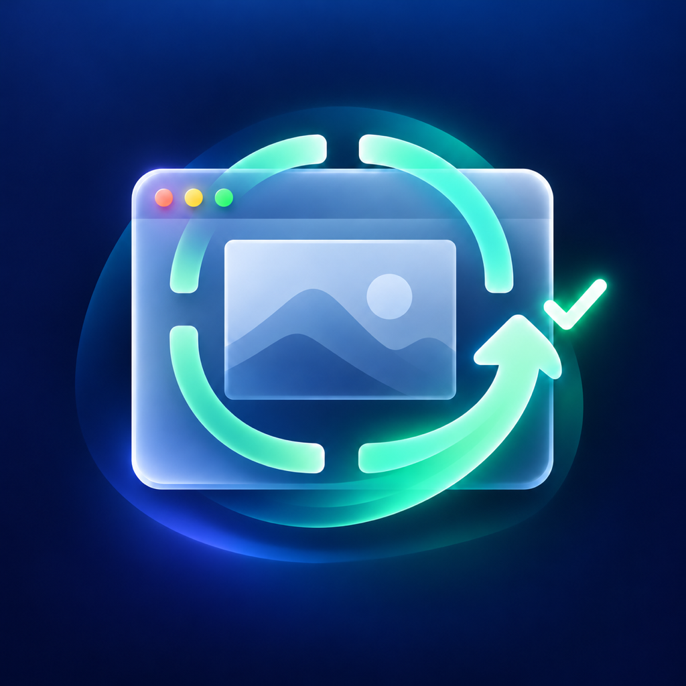

<p align="center">
  
</p>

<h1 align="center">微信截图恢复</h1>
<p align="center">为 macOS 官方微信恢复窗口截图能力</p>

微信截图恢复通过一个范围受限的运行时组件，拦截官方微信对 AppKit `NSWindow.setSharingType:` 的调用：请求值为 `0` 时改为允许截图的 `1`，其他值原样传递。工具只修改 `/Applications/WeChat.app`，不会读取聊天、账号或容器数据。

## 使用

1. 正常退出微信，打开“微信截图恢复.app”。
2. 检查预检结果并选择“备份并修复截图”。安装器会先保存、核验腾讯原版，再原子替换微信 App。
3. 由你重新打开微信，分别验收 macOS 截图和微信自带截图。
4. 若微信自带截图提示无权限，前往“系统设置 → 隐私与安全性 → 屏幕与系统音频录制”，删除旧的微信授权，重新添加当前 `/Applications/WeChat.app`，然后完全退出并重开微信。改签或回滚后可能需要再次绑定。
5. 撤销修改前先正常退出微信，再在工具中选择“恢复原版”。

安装会把腾讯签名改为本机 ad-hoc 签名，并为主程序增加运行时库加载例外；登录、钥匙串、应用组身份或官方更新可能受影响。恢复原版会恢复 App 程序包，不会回滚微信之后产生的账户或聊天数据。工具不更改 TCC、Gatekeeper 或隔离标记，也不自动启动微信。

## 为什么会有限制

本机 AppKit 对照测试显示，窗口的 `sharingType=0` 时系统截图失败，设为 `1` 后成功；静态分析也在微信二进制中找到传入 `0` 的 setter 调用路径，但没有证明所有微信窗口都会执行它。因此较合理的猜测是，微信把部分窗口排除在 macOS 屏幕共享或捕获之外，可能是隐私保护策略。具体目的尚未确认，特定窗口或版本行为也可能造成类似现象。

另一个待验证的猜测是：限制出现前曾用 Codex 等智能体自动化操作微信，微信可能把这类控制识别为风险并启用反截图策略。现有资料没有证明微信会因此切换窗口截图设置，也没有自动化操作前后的对照；两者是否存在因果关系仍未确认。

改签后微信自带截图出现的“无权限”提示是另一件事：它与 TCC 对应用签名身份的授权匹配有关，不是上述窗口截图限制的直接原因。

## 验证范围

实测环境为 macOS 27.0.1、Apple Silicon：

- WeChat 4.1.15（build 270135）
- WeChat 4.2.0.12；本机安装包元数据为 `CFBundleShortVersionString=4.2.0`、`CFBundleVersion=270348`

安装器会精确标记已验证的版本/build 组合。其他版本不会仅因版本号被硬性拦截，但结构预检通过不代表该版本已验证；安装前会明确提示未经实测。支持的 Mach-O 架构和安全检查仍须通过。

此工具只支持 macOS，不适用于 Windows。

## 从源码构建

需要 macOS 13 或更新版本，以及 Swift 6 工具链。项目不依赖外部 Swift 包。在项目根目录运行：

```sh
scripts/package-macos-app.sh
```

脚本生成 arm64 与 x86_64 通用 App：`../微信截图恢复.app`。GitHub Actions 会在推送到 `main` 后构建并上传可下载的 macOS App 工件。该工件使用 ad-hoc 签名，未经 Apple 公证；首次打开时 Gatekeeper 可能提示无法验证开发者。

## 实现结构

- SwiftUI 安装器：展示预检、备份、风险、安装与回滚状态。
- 安装事务：检查 Tencent Team ID、签名、版本/build、架构、隔离状态和进程；完整备份后暂存修改，再校验并原子切换。
- Objective-C 运行时组件：只对官方微信 Bundle ID 启用，按 AppKit selector 定位 setter，不依赖固定机器码偏移或版本表。

